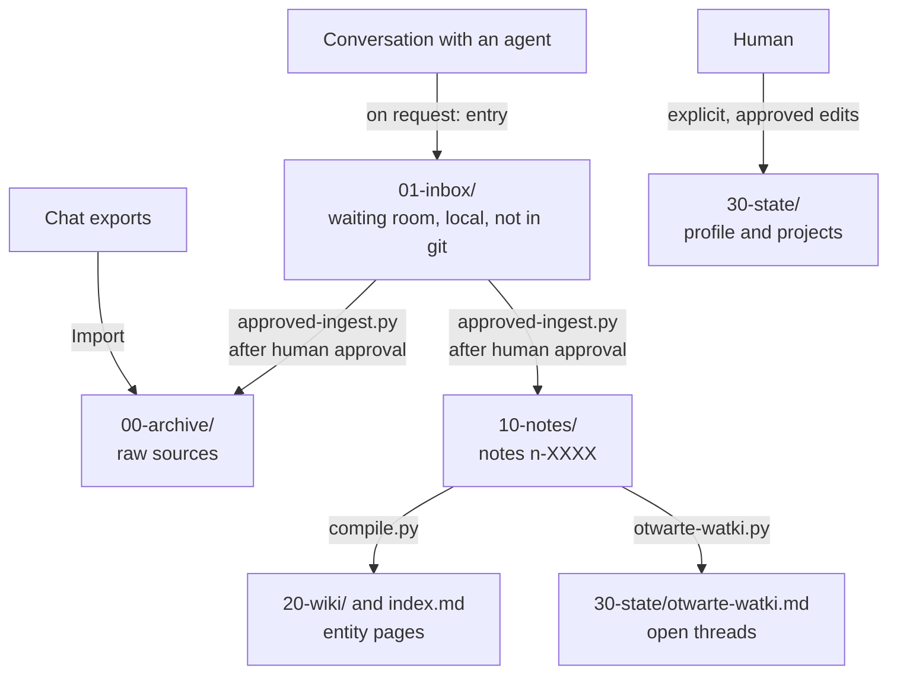

# Second Brain

An Obsidian vault that turns years of AI chat history into curated long-term memory: one source of facts for AI agents (Hermes Agent, Claude Code, Codex) and a wiki for the human who owns it.

This repository is a public showcase. It contains the tooling, the tests, the note format and the design, built and used daily on a private vault. It contains no personal notes.

## The problem

Conversations with chatbots end up scattered across several apps and turn into an archive nobody reads again. Every new agent starts from zero: it does not know what was already decided, what did not work, or what machine you are on. Retrieval over raw transcripts does not fix this, because it returns fragments of old conversations, including answers you no longer agree with.

Second Brain compiles instead of retrieving. Each conversation worth keeping becomes a short, single-topic note with tags from a closed vocabulary. Notes are compiled into wiki pages, and every claim an agent makes about you must cite a note that leads back to its source.

## How it works

Four layers, one writer per layer, information flows only downwards.



| Layer | Contents | Written by |
|---|---|---|
| `00-archive/` | raw chat exports, kept out of git; only reviewed excerpts that back a note are committed | Import, approved ingest |
| `01-inbox/` | entries an agent writes at the end of a conversation, one section per topic | the agent in the conversation, the human |
| `10-notes/` | one note = one topic, flat directory, filtered by tags | approved ingest only |
| `20-wiki/` | one page per entity, rebuilt from the notes | `compile.py` only |
| `30-state/` | hand-written profile and project list | the human, after review |
| `90-meta/` | scripts, tests, contracts, manifest, ID counter | tools and the human |

## Design principles

- **One writer per layer.** An agent in a conversation can only write to the inbox, so it can never overwrite something a human approved.
- **Folders encode facts, tags encode judgements.** Date and source go into paths; topic, project and kind go into frontmatter, so changing your mind is a metadata edit, not a migration.
- **A closed vocabulary.** [`taxonomy.md`](taxonomy.md) is the only source of tags. [`90-meta/gen-schema.py`](90-meta/gen-schema.py) turns it into a JSON Schema, so the vocabulary and the validator cannot drift apart.
- **Compiling the wiki is deterministic and free.** [`90-meta/compile.py`](90-meta/compile.py) groups and quotes notes without calling a model. An entity gets a page when it appears in at least 8 notes and in less than 20% of the corpus (the ceiling filters out background noise such as the name of your OS).
- **Every note is approved by a human.** No nightly jobs and no model inferring facts about you. The agent drafts a payload, the script checks it, the human says yes.
- **Idempotent and recoverable.** A `content_hash` in an append-only manifest marks what was processed; rerunning the same payload is a no-op, and an interrupted write rolls back from a journal.
- **Git is the sync layer, with a guard.** Several machines push to one repository. Publishing refuses without a recent `git fetch`, because a stale clone would hand out note IDs that already exist elsewhere.

## Taxonomy in brief

[`taxonomy.md`](taxonomy.md) is in Polish because the scripts parse it. In short:

| Axis | Meaning | Per note |
|---|---|---|
| `domains` | what the conversation is about, e.g. `linux-config`, `java`, `zakupy-research` (shopping research), `zdrowie` (health) | 1-3 |
| `kind` | what it tried to achieve: `troubleshooting`, `how-to`, `decision`, `learning`, `build` and five more | exactly 1 |
| `projects` | named long-running efforts; empty for most notes | 0-3 |
| `status` | `resolved`, `unresolved`, `active`, `superseded`, `evergreen` | exactly 1 |
| `signal` | value of the content from 1 to 5; a note is created only from 2 up | exactly 1 |

- The vocabulary is closed: neither a model nor an agent may invent a tag. A missing one is proposed and waits for a human.
- Every domain has explicit boundaries with examples: "the game does not start under Linux" is Linux gaming, "how to build a character" is about the game itself.
- Filtered fields (`domains`, `kind`, `projects`, `status`) are strict enums; raw fields (`entities`, `summary`) stay free-form, and the step that consumes them normalises them.
- `sensitive: true` (health, finances, third parties) keeps a note out of git and out of the wiki.

## What is in this repository

| Path | Purpose |
|---|---|
| [`taxonomy.md`](taxonomy.md) | closed tag vocabulary on five axes (domain, kind, project, status, signal); the example project list is a placeholder |
| [`90-meta/_template-notatki.md`](90-meta/_template-notatki.md) | note format: frontmatter plus seven fixed sections |
| [`90-meta/approved-ingest.py`](90-meta/approved-ingest.py) | publishes one approved note and its source excerpt (`--check` validates without writing) |
| [`90-meta/approved-status.py`](90-meta/approved-status.py) | the only way to change an existing note: mark it `resolved` or `superseded` |
| [`90-meta/publikuj-partie.py`](90-meta/publikuj-partie.py) | publishes an approved batch in one run: check, publish, validate, compile, commit, push, verify on `origin/main`, clean the inbox |
| [`90-meta/walidator.py`](90-meta/walidator.py) | checks rules a JSON Schema cannot express, including a credential heuristic; used as a `pre-commit` hook |
| [`90-meta/compile.py`](90-meta/compile.py) | rebuilds `20-wiki/` and `index.md`; entity aliases and a stoplist live next to it |
| [`90-meta/otwarte-watki.py`](90-meta/otwarte-watki.py) | regenerates the list of open threads from notes with status `unresolved` or `active` |
| [`90-meta/inbox-sprzatanie.py`](90-meta/inbox-sprzatanie.py) | removes inbox entries whose note has been published |
| [`90-meta/eksport-hermes.py`](90-meta/eksport-hermes.py) | exports Hermes Agent sessions (read-only) as a source for notes |
| [`90-meta/hermes/podepnij.py`](90-meta/hermes/podepnij.py), [`90-meta/hermes/vault-start.py`](90-meta/hermes/vault-start.py) | optional: hook a machine up to shared agent skills and rules, and run a safe `git pull --ff-only` at login |
| [`90-meta/tests/`](90-meta/tests/) | unit tests on synthetic data, including a bare-repo fixture for the git guard |
| [`examples/`](examples/) | two synthetic payloads for the quick start |

## Quick start

Requirements: Linux, git, Python 3.11+, [PyYAML](https://pypi.org/project/PyYAML/) and [jsonschema](https://pypi.org/project/jsonschema/).

```bash
python3 -m unittest discover -s 90-meta/tests
```

To see the whole flow, fork the repository, clone your fork and publish the two example notes. The batch script commits and pushes to your fork:

```bash
git fetch origin
python3 90-meta/publikuj-partie.py --check examples/przyklad-1.json examples/przyklad-2.json
python3 90-meta/publikuj-partie.py -m "example notes" examples/przyklad-1.json examples/przyklad-2.json
python3 90-meta/compile.py 1 1      # thresholds lowered so two notes produce wiki pages
```

You get two notes in `10-notes/`, their source excerpts in `00-archive/inbox/`, one open thread in `30-state/otwarte-watki.md` and a commit on `origin/main`. Running the same command again changes nothing.

## Building your own

1. Inventory your chat exports with a script before designing anything: the shape of the archive decides the taxonomy.
2. Rewrite [`taxonomy.md`](taxonomy.md) for your own domains and projects, then run `python3 90-meta/gen-schema.py`.
3. Write the instructions your agents read first: who may write where, how to answer from the vault, where things live. In the private vault these are `AGENTS.md`, `context-rule.md` and `router.md` in the root.
4. Have agents append inbox entries at the end of conversations, and turn them into notes with `approved-ingest.py` after reviewing each one.
5. Add the validator as a `pre-commit` hook and keep raw exports out of git: they contain pasted passwords and keys.

## Lessons learned

- Write the control files from the real file system, not from the design document; the first version pointed agents to six files that did not exist.
- Check whether a script is enough before paying a model. Compiling the wiki looked like a model task and turned out to be grouping and quoting.
- Entity fragmentation is worse than bad synthesis: one thing under four names never reaches the page threshold, while its predecessor's page keeps claiming to be current. Keep an alias file.
- A number is a reason to look, not a conclusion. The same tag cardinality once meant tag drift and once meant the real shape of the archive.
- A secret in git history stays in history. Scan the whole history before the first push.
- Instructions that must always apply belong in the always-loaded prompt, not in a skill the agent may or may not pick.

## Glossary

The vault is maintained in Polish, so are file names and messages.

| Polish | English |
|---|---|
| notatka, `10-notes/` | note |
| walidator | validator |
| publikuj-partie | publish batches |
| otwarte-watki | open threads |
| inbox-sprzatanie | inbox cleanup |
| aliasy-encji, stoplista-encji | entity aliases, entity stoplist |
| podepnij | hook up (a machine) |
| przyklad | example |

## License

[MIT](LICENSE)
